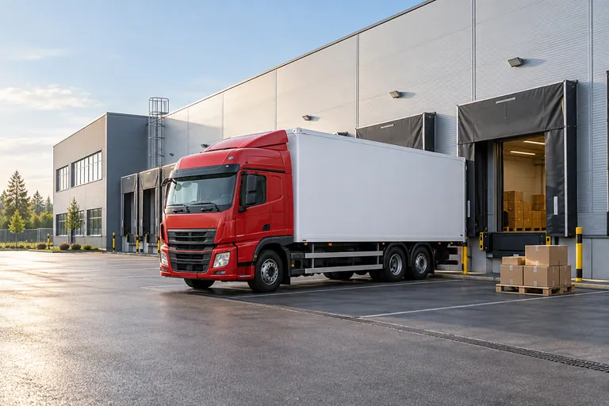

# Изображение для примера picture

Один оригинальный демонстрационный кадр: красный грузовой автомобиль с белым кузовом у современного склада.
Создан встроенным OpenAI ImageGen 28 сентября 2026 года для Storybook и документации компонента изображения.
Это вымышленная сцена, а не фотография реального объекта ПЭК.

Все варианты сохраняют полный кадр и пропорции 3:2, без обрезки и искусственного увеличения.

| Ширина | Высота | Файлы |
| --- | --- | --- |
| 480 px | 320 px | `logistics-terminal-480.avif`, `.webp` |
| 768 px | 512 px | `logistics-terminal-768.avif`, `.webp` |
| 1200 px | 800 px | `logistics-terminal-1200.avif`, `.webp` |
| 1536 px | 1024 px | `logistics-terminal-1536.avif`, `.webp` |

Всего 8 файлов изображений, 617 748 байт (около 603,27 КиБ).
Это сумма всех альтернатив; одно отображаемое изображение не должно загружать их все одновременно.

Все файлы подготовлены непосредственно из исходного PNG с помощью Sharp 0.35.4.
Исходный PNG в проекте не хранится; его размеры, объём и SHA-256 оставлены только как сведения о происхождении.
Точный запрос генерации, параметры кодирования, MIME-типы, размеры, объём и SHA-256 каждого файла записаны
в [manifest.json](manifest.json).

Генератор вернул 1536 × 1024 px при запрошенных 3072 × 2048 px. Это фактический предел детализации набора:
для изображения шириной 1256 CSS px исходник достаточен при DPR 1, но не обеспечивает полное разрешение DPR 2.
Файлы большего размера искусственно не создавались.

Предлагаемый `alt`: «Красный грузовой автомобиль с белым кузовом у погрузочных ворот современного склада».
В конкретной документации значение можно уточнить по контексту; декоративному изображению нужен пустой `alt`.

AVIF предназначен для `source`, WebP — для `img` и его набора `srcset`.
Размерные дескрипторы `srcset` должны совпадать с фактической шириной файлов,
а `sizes` — с шириной места изображения в конкретном примере.

Пример использования: [история компонента изображения](../../../stories/project/image.stories.js).
При подключении импортировать только необходимые варианты, а не весь каталог.
Ресурсы предназначены для витрины и документации. При переносе компонента на страницу нужно разместить
предназначенные для неё изображения в папке страницы, заменить пути и наборы `srcset`, указать их реальные
размеры, подходящий `alt` и `sizes` для фактической ширины изображения. Готовые страницы не должны зависеть
от файлов или подстановок внутри `ui-kit`.

